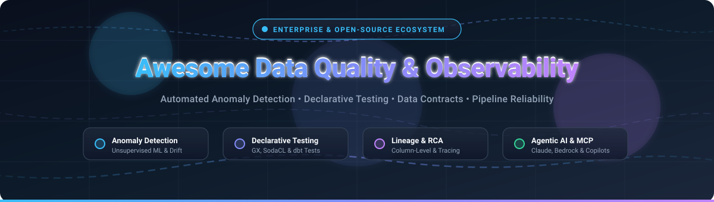

# 🔍 Awesome Data Quality & Observability 🚀

  <strong>Curated catalog of top enterprise SaaS platforms and open-source frameworks for data observability, pipeline testing, data contracts, and automated anomaly detection.</strong>

  
  
  
  
  
  
  

---

## 📖 Table of Contents

- [🌐 Sector Overview & Market Dynamics](#-sector-overview--market-dynamics)
- [☁️ SaaS / Hosted Platforms](#️-saas--hosted-platforms)
- [🛠️ Open-Source GitHub Projects](#️-open-source-github-projects)
- [🤝 How to Contribute](#-how-to-contribute)
- [💖 Support & Community](#-support--community)
- [📈 Star History](#-star-history)
- [⚠️ Disclaimer](#️-disclaimer)

---

## 🌐 Sector Overview & Market Dynamics

The global **Data Quality & Observability** market is estimated at **$2.5B–$3.8B in 2026** and projected to surpass **$7B+ by 2030** (growing at a 20%+ CAGR), fueled by enterprise cloud warehouse adoption and mission-critical GenAI/agentic data pipeline dependencies. 

The sector remains **moderately fragmented**: while category front-runners like Monte Carlo, Acceldata, Bigeye, and Anomalo command substantial enterprise market share and hyperscalers (IBM, Snowflake, Databricks) continue strategic acquisitions and native tooling rollouts, it is **not a winner-take-all market** due to diverse architectural paradigms—ranging from developer-first declarative test engines (Great Expectations, dbt, Soda) and zero-copy in-place query observability (Telmai) to legacy enterprise data estate migration solutions.

---

## ☁️ SaaS / Hosted Platforms

| 🏢 Platform | 💰 Company Scale (Valuation / Revenue) | 🏷️ Starting Pricing Tier | 🎁 Free Tier / Trial Limits | ⚡ Key Capabilities & Best For |
| :--- | :--- | :--- | :--- | :--- |
| **IBM Databand** | **~$215B Market Cap** (Parent IBM; ~$150M Databand acquisition) | **~$450/month** (Essentials tier baseline via IBM Cloud/watsonx, scaling to $1,750+/mo) | **30-day free trial** (Full feature access via IBM Cloud / watsonx.data; no permanent free plan) | Observability software for data pipelines (DAGs, runs, tasks) and warehouses with hourly snapshots, run live views, and self-hosted deployment options. Best for IBM ecosystem users. |
| **Monte Carlo** | **$1.6B Valuation** (Series D unicorn; $236M+ raised) | **~$25,000 – $50,000/year** (Baseline entry/AWS Marketplace package; Start tier covers up to 10 users & 1,000 monitors) | **14 to 30-day POC / Pilot** (Tailored evaluation on 1–3 warehouses/lakes and subset of critical tables; no permanent free plan) | Leading data + AI observability platform across warehouses, lakes, BI, and AI agents with GraphQL/Push Ingest APIs and 56-tool MCP server. Best for end-to-end enterprise coverage. |
| **Acceldata (ADOC)** | **~$360M Valuation** (Series C; $106M+ raised) | **~$100,000/year** (Enterprise platform tier based on compute/volume starting ~$0.20/GB or TB/month units) | **30-day free trial** (Full access to data observability cloud, automated scanning, and policies; no permanent free plan) | Data Observability Cloud with Agentic Data Management (ADM) providing natural-language incident drilldowns, 60+ data connectors, and drift/reconciliation policies. Best for guided incident RCA. |
| **Bigeye** | **~$180M Valuation** (Series B; $68.5M+ raised) | **~$45,000/year** (Entry AWS Marketplace tier covering up to 100 actively monitored tables; $75,000/yr for 300 tables) | **14 to 30-day Proof of Concept (PoC)** (Hands-on evaluation scoped to target warehouse connectors and sample CDEs; no permanent free plan) | Enterprise data observability with deep legacy connector support (Informatica, DB2, SSIS, DataStage), bigAI incident copilot, and cross-database join rules. Best for enterprise legacy migrations. |
| **Anomalo** | **~$165M Valuation** ($100M–$250M range; $72M+ raised) | **~$58,000/year** (Entry tier via AWS Marketplace / Vendr median ~$115k/yr based on monitored table count) | **14 to 30-day enterprise pilot / POC** (Scoped evaluation on up to 50–100 production tables with full ML anomaly detection; no permanent free plan) | AI-native enterprise data quality with unsupervised ML across structured, semi-structured, and unstructured data, backed by Databricks and Snowflake. Best for zero-rule automated ML profiling. |
| **Soda (Soda Cloud)** | **~$70M Valuation** ($27.9M raised; $14M 2024 round) | **$750/month** (Team tier, includes core platform features and base SPUs; previously $8/dataset/mo) | **Free-forever plan: Up to 3 production datasets** (Includes pipeline testing, metrics observability, and alerting; unlimited time) | AI-native automated data quality platform with SodaCL checks-as-code, no-code rule builder, and self-serve dataset monitoring. Best for transparent modular adoption. |
| **Metaplane** | **~$50M Valuation** ($23M raised; Series A led by Felicis) | **$10/monitored table/month** (Pro tier; minimum spend commonly starts at ~$500/month with 12 users) | **Free-forever plan: Up to 10 monitored tables & 4 users** (Includes automated anomaly detection, schema tracking; also offers a 14-day Pro trial) | ML-based anomaly detection with end-to-end column-level lineage and Chrome extension to verify dashboard data directly in BI tools. Best for fast 30-minute setup and BI integration. |
| **Telmai** | **~$25M Valuation** ($11.3M raised; YC alum & Seed led by Glasswing) | **~$25,000 – $50,000/year** (Entry annual contract based on in-place query units and data source volume) | **14-day guided trial / sandbox** (Hands-on evaluation environment connecting to sample cloud warehouse or private VPC; no permanent free plan) | AI-powered data observability for agentic workflows with continuous validation (structured/unstructured), zero-copy decoupled metrics, and MCP-compliant server. Best for agentic AI pipelines. |
| **Lightup** | **~$20M Valuation** ($9.0M raised; Series A led by a16z) | **~$24,000 – $36,000/year** (Cloud annual subscription baseline; custom Enterprise tier for hybrid/on-prem) | **30-day cloud trial** (Demo workspace sandbox capped at 5 users and sample warehouse connections; no permanent free plan) | Next-generation data quality with automatic data profiling, SQL/no-code custom metrics, slicing, and native Claude Code MCP integration. Best for flexible metric slicing and MCP agent access. |

---

## 🛠️ Open-Source GitHub Projects

Sorted by GitHub star count in descending order:

1. **[OpenMetadata](https://github.com/open-metadata/OpenMetadata)**   
   **Unified metadata, data discovery, quality profiling, and end-to-end lineage platform** (Apache-2.0) . Features built-in data profiler, automated tests, no-code data quality dashboards, freshness alerts, column-level lineage, and rich governance integrations across 70+ connectors .

2. **[dbt-core](https://github.com/dbt-labs/dbt-core)**   
   **The standard for analytics engineering transformation and pipeline testing** (Apache-2.0) . Built-in declarative testing (`not_null`, `unique`, `accepted_values`, `relationships`), custom data tests, singular tests, and integration with dbt-expectations .

3. **[DataHub](https://github.com/datahub-project/datahub)**   
   **Extensible metadata platform for data observability and governance** (Apache-2.0, originally by LinkedIn) . Supports real-time column-level lineage, automated dataset assertions, data quality history tracking, impact analysis, and alerts via Slack and Teams .

4. **[Great Expectations (GX)](https://github.com/great-expectations/great_expectations)**   
   **The open standard for declarative data testing and documentation** (Apache-2.0) . Features expressive Expectation Suites, automated Checkpoints, and human-readable Data Docs. Processes data directly in-place across Snowflake, Databricks, Redshift, S3, and Postgres .

5. **[Cleanlab](https://github.com/cleanlab/cleanlab)**   
   **The standard data-centric AI package for data quality and label reliability** (AGPL-3.0) . Automatically detects label errors, outliers, duplicates, and data issues in tabular datasets, NLP text, and computer vision images to enhance machine learning fidelity .

6. **[Evidently](https://github.com/evidentlyai/evidently)**   
   **Open-source ML and data observability framework** (Apache-2.0) . Evaluates, tests, and monitors data drift, target drift, data quality metrics, and machine learning models in production or CI/CD pipelines with interactive visual reports .

7. **[Deequ](https://github.com/awslabs/deequ)**   
   **Declarative data quality testing at petabyte scale on Apache Spark** (Apache-2.0, by AWS) . Defines "unit tests for data" on large distributed datasets, calculating metrics and constraint verification seamlessly over billions of rows .

8. **[whylogs](https://github.com/whylabs/whylogs)**   
   **Open-source standard for data logging, profiling, and ML telemetry** (Apache-2.0, by WhyLabs) . Lightweight statistical profiling enabling privacy-preserving, zero-data-movement drift detection and quality monitoring on streaming and batch data .

9. **[OpenLineage](https://github.com/OpenLineage/OpenLineage)**   
   **Open standard for decentralized data lineage collection and pipeline observability** (Apache-2.0, LF AI & Data Foundation) . Traces dataset dependencies and runtime operational metrics across Airflow, Spark, dbt, Flink, and Dagster .

10. **[Soda Core](https://github.com/sodadata/soda-core)**   
    **Lightweight SQL-native library and CLI for data quality validation** (Apache-2.0) . Uses human-readable SodaCL (Soda Checks Language) to turn checks into SQL queries with 18+ pre-built database connections .

11. **[Elementary](https://github.com/elementary-data/elementary)**   
    **dbt-native data observability and anomaly detection package** (Apache-2.0) . Installs seamlessly as a dbt package to monitor volume anomalies, freshness, and test failures directly within your data warehouse without external infrastructure .

12. **[DataProfiler](https://github.com/capitalone/DataProfiler)**   
    **Automated data profiling, PII detection, and schema analysis** (Apache-2.0, by Capital One) . Uses deep learning and rule-based profilers to identify data structures, sensitive information (PII/NPI), and quality anomalies in tabular and unstructured datasets .

13. **[re_data](https://github.com/re-data/re-data)**   
    **Open-source data quality framework for modern data warehouses** (MIT) . Computes data metrics, alerts on anomalies, and generates interactive data quality dashboards directly inside Snowflake, BigQuery, and Redshift .

14. **[Data Contract CLI](https://github.com/datacontract/cli)**   
    **CLI and Python toolkit for data contract specification, schema testing, and CI/CD validation** (MIT) . Enforces data contracts between data producers and consumers using declarative YAML contracts and automated runtime checks .

---

## 🤝 How to Contribute

Contributions are welcome and highly appreciated! 🎉

1. 🍴 Fork the repository.
2. 🌿 Create a new branch (`git checkout -b feature/new-tool-entry`).
3. 📝 Add or update entries following the established format (include official links, pricing, free limits, and badges).
4. 🚀 Open a Pull Request with a concise summary of the changes.

Please make sure descriptions remain factual, informative, and up-to-date.

---

## 💖 Support & Community

If you find this curated collection valuable for your engineering workflows:

- ⭐ **Star this repository** to help others discover it!
- 🍴 **Fork the repo** to keep a personal reference.
- 📣 **Share with peers** across Slack, Discord, LinkedIn, or Twitter/X.
- ☕ **Support ongoing maintenance**: You can sponsor or buy a coffee via the [GitHub Sponsor Dashboard](https://github.com/sponsors/ishandutta2007).

---

## 📈 Star History

---

## ⚠️ Disclaimer

- This is a **community-curated catalog** — not an endorsement of any commercial platform or open-source library.
- Data quality and observability tools processing sensitive enterprise workloads must comply with security and regulatory standards (GDPR, HIPAA, SOC 2, CCPA).
- **Rules vs. ML Trade-offs**: Declarative testing tools (e.g., Great Expectations, dbt, Soda Core) deliver deterministic, contract-based precision for known invariants. ML-based anomaly platforms (Monte Carlo, Anomalo, Metaplane) detect unknown deviations and trend drift without manual check writing. Mature enterprise data architectures typically blend both paradigms.
- **Agentic AI Frontier**: Modern observability increasingly interfaces directly with coding assistants and autonomous agents via MCP (Model Context Protocol), Claude Code, and API toolkits.

---

**Built with ❤️ for data engineers, analytics teams, and AI practitioners.**

